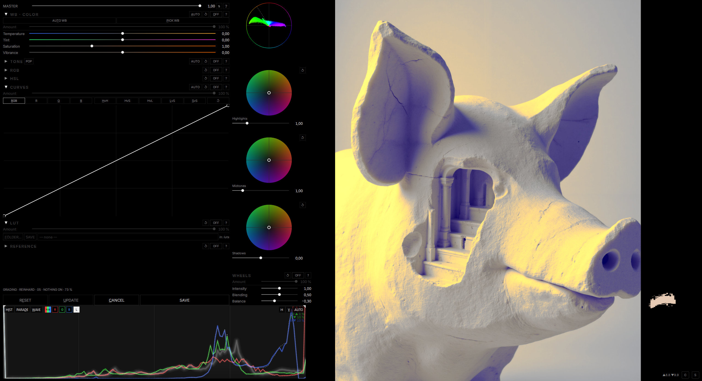

# REFgrade — Colour Grading by Reference (Krita plugin · standalone in progress)

> **Prototype.** Tested only on Windows 11 with Krita 6.0.4 (beta) at 2560×1440. Expect rough edges —
> comments, bug reports and ideas are very welcome via GitHub Issues.


Transfers the light and color mood of a reference image onto your image in Krita.
Adjust the result with grading sliders, apply it as a new layer, or export as a 3D LUT (.cube).

<a href="docs/screenshot.jpg"></a>

## Prerequisites

- Krita 6.0.4 (Beta, Qt6), Windows 11
- A **system Python 3.12** (not Krita's built-in one) with `torch`, `numpy`, `kornia` and `pillow`.
  RefGrade runs its image engine as a separate worker process with this Python; the ZIP does not install it.
  For GPU use install the CUDA build of torch — pick the index that matches your driver on
  [pytorch.org](https://pytorch.org/get-started/locally/):

  ```
  py -3.12 -m pip install torch --index-url https://download.pytorch.org/whl/cu128
  py -3.12 -m pip install numpy kornia pillow
  ```

  Without CUDA the worker runs on the CPU (much slower).
- RefGrade finds the Python via the environment variable `REFGRADE_PYTHON`, otherwise the first
  `python` / `python3` on `PATH` (Windows Store stubs are skipped), otherwise the newest
  `%LOCALAPPDATA%\Programs\Python\Python3*`. To force a specific interpreter, set `REFGRADE_PYTHON`
  to its full path (e.g. `C:\Python312\python.exe`) as a user environment variable and restart Krita.

## Installation

1. Download `ref_grade-x.y.z.zip` from the GitHub Releases page. Do not unzip it.
2. In Krita: **Tools → Scripts → Import Python Plugin from File…** and choose the ZIP.
3. Confirm the activation question, then restart Krita.
4. Open RefGrade from the **Filter → RefGrade** menu with a paint layer active.

**Update:** restart Krita and, *before* opening RefGrade, import the new ZIP the same way, confirm the
overwrite, restart Krita. (While RefGrade has been opened, its worker keeps files in the plugin folder busy
until Krita closes, and the overwrite can fail.)

**Uninstall:** **Settings → Configure Krita → Python Plugin Manager**, untick RefGrade, restart.
To remove it completely, also delete `pykrita\ref_grade`, `pykrita\ref_grade.desktop` and
`actions\ref_grade.action` from Krita's resource folder (**Settings → Manage Resources → Open Resource Folder**;
usually `%APPDATA%\krita`).

## Usage (6 lines)

1. Open the RefGrade dialog from the Filter menu.
2. Load one or more reference images into the slots (drag & drop or click).
3. Choose a method (Reinhard / MKL / Zonal) and press FIT to auto-match.
4. Fine-tune with the sliders and color wheels; use SOLO to isolate a section.
5. Press OK to apply as a new layer, or LUT… to export a .cube file.
6. CANCEL closes without applying.

## LUT output

Exported .cube files are saved to the folder you choose in the file dialog
(default: `%APPDATA%\krita\luts`).

## Troubleshooting

- Plugin missing from the menu: enable it in **Settings → Configure Krita → Python Plugin Manager** and restart Krita.
- Worker does not start (dialog shows an error about the worker): Python or its packages were not found.
  Check that `py -3.12 -c "import torch, numpy, kornia, PIL"` works, or set `REFGRADE_PYTHON` (see Prerequisites).
- Worker log: `%TEMP%\ref_grade\worker.log`
- If the dialog shows "ERROR · …", check the log for the full traceback.

## For developers

- `python install.py` links the repository into Krita (a directory junction to `plugin/ref_grade`, plus the
  `.desktop` and `.action` files); `python install.py --uninstall` removes it; `--dry-run` only prints the targets.
  In this layout the plugin uses `core/` from the repository.
- `python tools/build_zip.py` builds `dist/ref_grade-<version>.zip` (version from `core/refgrade/version.py`),
  with the worker bundled as `ref_grade/core`.
- **Never import the ZIP while the dev junction exists** — the importer would overwrite the repository's
  plugin files through the junction. Run `python install.py --uninstall` first.
