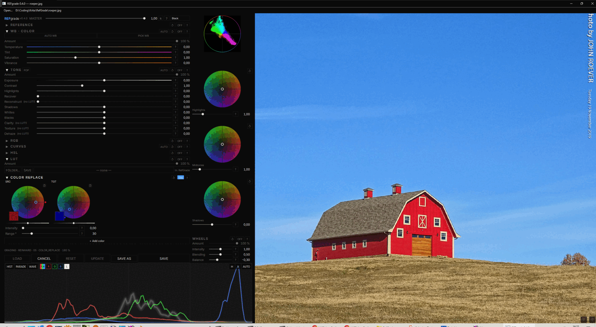

# REFgrade — Colour Grading (Krita plugin · standalone app)

> **Hobby project — not bug-free.** Tested only on Windows 11 with Krita 6.0.4 (beta) at
> 2560×1440. Expect rough edges, crashes, and things that simply don't work yet.
> If you hit a problem, please file an issue on GitHub — bug reports, crash logs and
> "this button does nothing" are all equally welcome.

REFgrade is a colour grading tool for photographs and digital paintings. It runs as a
**Krita plugin** (the result becomes a new layer) and as a **standalone app** without
Krita, and the whole grading can be exported as a 3D LUT (`.cube`).

<a href="docs/screenshot.jpg"></a>

Current version: see `plugin/ref_grade/version.py`.

## Features

- **Reference transfer:** load up to four reference images and transfer their light and
  colour mood — **Reinhard** (robust default), **MKL** (stronger), **Zonal** (shadows,
  midtones and highlights matched separately), or **PAIR** (learns a LUT from a
  before/after pair). **FIT** auto-sets the sliders to the reference.
- **TONE:** Exposure, Contrast, Highlights, Shadows, Whites, Blacks, Clarity, Texture and
  Dehaze — plus **Recover** (soft highlight rolloff) and **Reconstruct** (partially
  rebuilds clipped channels) for blown highlights. **POP** applies a preset recipe.
- **WB · COLOR:** Temperature, Tint, Saturation, Vibrance, with **AUTO WB** and
  **PICK WB** (pick a point that should be neutral).
- **RGB:** Gamma / Offset / Gain for Master, Red, Green and Blue, with zone control
  (shadows / midtones / highlights).
- **CURVES:** the RGB curve plus five hue curves (HvH, HvS, HvL, LvS, SvS).
- **WHEELS:** Lift / Gamma / Gain wheels with Balance, Blending and Intensity.
- **HSL:** six colour bands × Hue / Sat / Light, Lightroom-style.
- **COLOR REPLACE:** pick a colour with the pipette and replace it — up to eight
  instances at once, each with its own HSL-distance mask (Range), Intensity and source /
  target pipettes.
- **LUT:** load `.cube` files from any folder; export the current grading as `.cube`
  (Clarity, Texture, Dehaze and Reconstruct are not part of a LUT).
- **Chapters:** every section is a chapter — switch it on/off, weight it (Amount),
  **SOLO** it, reset it, and reorder the chain by drag & drop.
- **Scopes:** Histogram, Parade, Waveform, Vectorscope.
- **A "?" help button at every slider.**
- **Colour schemes:** Black, Dark Grey, Light Grey, White.

**Most proud of:** the **live COLOR REPLACE** — pick a colour and watch it swap live as you work.
It's a beast.

Exported `.cube` files go to the folder you choose in the file dialog.

## Installation — standalone

1. Download [refgrade-0.4.0.zip](https://github.com/metamountain/REFgrade/raw/main/releases/refgrade-0.4.0.zip) and extract it.
2. Double-click `refgrade.bat`.

On the first start `refgrade.bat` downloads `uv`, installs Python 3.12 and PyQt6 (plus numpy and
pillow) into the runtime folder — no Python installation and no admin rights needed. The GUI then
opens the **torch setup dialog**: it detects your GPU and pre-selects the matching PyTorch build
(see [System requirements](#system-requirements)); you can change the build and the install location
and watch a live log. Your system Python is not modified.

```
refgrade.bat [image.jpg]       optional: open this image directly
refgrade.bat --setup           show the setup dialog again (set up the runtime anew / change location)
```

The runtime lives in `%LOCALAPPDATA%\RefGrade\runtime` unless you choose another folder in the setup
dialog (stored in `%APPDATA%\RefGrade\config.json`; the environment variable `REFGRADE_RUNTIME`
overrides it).

**Use existing Python:** the dialog's **Use existing Python…** button takes your own Python that can
import `torch`, `numpy`, `kornia` and `PIL` (saved as `python_exe` in `config.json`) instead of
installing a runtime.

## Installation — Krita plugin

1. Download [ref_grade_plugin.zip](https://github.com/metamountain/REFgrade/raw/main/releases/ref_grade_plugin.zip). Do not unzip it.
2. In Krita: **Tools → Scripts → Import Python Plugin from File…** and choose the ZIP.
3. Confirm the activation question, then restart Krita.
4. Open REFgrade from **Filter → RefGrade** with a paint layer active.
5. **First time only:** the runtime dialog appears (same dialog as in the standalone app — detected
   build, install location, **Use existing Python…**). Install, then the REFgrade dialog opens.

**Update:** the dialog's **UPDATE** button checks GitHub and replaces the plugin. This works for the
ZIP installation only; with a git checkout use `git pull`. Alternatively import the new ZIP the same
way *before* opening REFgrade (once opened, its worker keeps files busy until Krita closes).

**Uninstall:** **Settings → Configure Krita → Python Plugin Manager**, untick REFgrade, restart.
To remove it completely also delete `pykrita\ref_grade`, `pykrita\ref_grade.desktop` and
`actions\ref_grade.action` from Krita's resource folder (**Settings → Manage Resources → Open Resource
Folder**, usually `%APPDATA%\krita`). To free the disk space, delete the runtime folder.

## Using the standalone app

- Starts **maximized with an empty window**. Load an image with **Open image…** / `Ctrl+O`,
  `Ctrl+V` (paste a screenshot) or by dragging a file onto the window.
- **LOAD** switches to another image and **keeps the current grading**.
- **SAVE** writes `<name>_rg.<format>` next to the original (PNG, JPEG or TIFF; other source formats
  are saved as PNG) without a dialog; the grading stays open. A pasted screenshot asks where to save.
- **SAVE AS** opens a file dialog.
- **CANCEL** closes the image. `Esc` does not close it.

In Krita: load references into the slots, choose a method (Reinhard / MKL / Zonal / Pair), press
**FIT** to auto-match (not for Pair, which learns the LUT from a before/after pair), adjust, and
press **SAVE** to apply the grading as a new layer above the active one. **SOLO** (in a section
header) isolates that section; **CANCEL** closes without applying.

## See it live

<a href="docs/color_replace.gif"></a>

## System requirements

- Windows (tested on Windows 11). Krita 6.0.4 (Qt6) for the plugin; the standalone app needs no Krita.
- A GPU is optional but makes rendering much faster. The setup dialog picks the build:

| Build | Chosen for | Download (approx.) |
|-------|------------|--------------------|
| NVIDIA CUDA 13 | NVIDIA GPU, driver reporting CUDA 13 or newer | 3.0 GB |
| NVIDIA CUDA 12 | NVIDIA GPU, driver reporting CUDA 12.6–12.x (older GPUs only) | 2.8 GB |
| AMD ROCm (preview) | supported Radeon RX 7000/9000 and certain PRO / Ryzen AI GPUs | 2.1 GB |
| Intel Arc (XPU) | Intel Arc | 1.5 GB |
| CPU only | no supported GPU, or driver too old (much slower on large images) | 0.25 GB |

- Free disk space: the setup dialog requires about twice the download size at the install location,
  which must be writable and have an ASCII-only path.

## Troubleshooting

- **Plugin missing from the menu:** enable it in **Settings → Configure Krita → Python Plugin Manager**
  and restart Krita.
- **Setup dialog appears every time:** the runtime check failed. Run
  `%LOCALAPPDATA%\RefGrade\runtime\venv\Scripts\python.exe -c "import torch, numpy, kornia, PIL"`.
  If that fails, delete the runtime folder and run the setup again.
- **Install fails (network error):** the download of `uv` or PyTorch was interrupted. Check your
  connection and retry.
- **GPU not detected:** update your GPU driver. For NVIDIA the CUDA version is read from `nvidia-smi`;
  the setup dialog shows which build was chosen and why. A driver too old for the GPU build falls back to CPU.
- **Worker does not start / dialog shows "ERROR · …":** see `%TEMP%\ref_grade\worker.log`.

## Development

```
python -m pytest core/tests -q            # tests (or core/tests/run_tests.py)
python build/make_release_zip.py          # dist/refgrade-<version>.zip (standalone, source only)
python build/make_plugin_zip.py           # dist/ref_grade_plugin.zip (Krita plugin with bundled core)
```

- `python install.py` links the repository into Krita (a directory junction to `plugin/ref_grade`, plus
  the `.desktop` and `.action` files); `--uninstall` removes it, `--dry-run` only prints the targets.
  **Never import the plugin ZIP while the junction exists** — it would overwrite the repository's files.
  Run `python install.py --uninstall` first.

### Documentation

- [Features](docs/FUNKTIONEN.md)
- [UI Decisions](docs/UI_ENTSCHEIDUNGEN.md)
- [Torch/ONNX Facts](docs/TORCH_ONNX_FACTS.md)
- [Concept](KONZEPT.md)
- [Backlog](BACKLOG.md)

## License

MIT — see [LICENSE](LICENSE).
